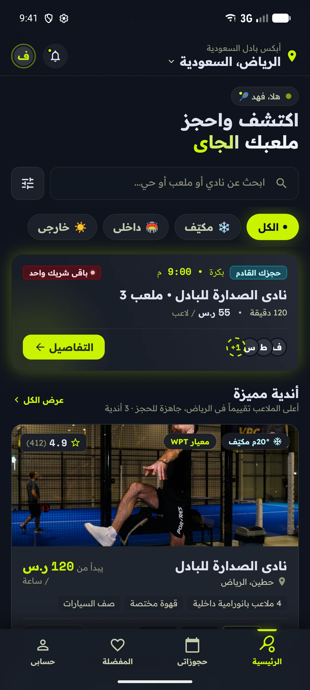
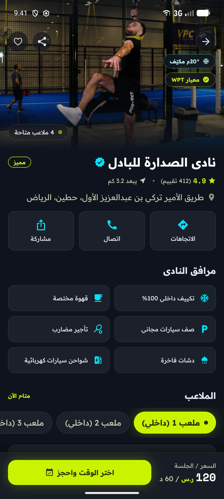
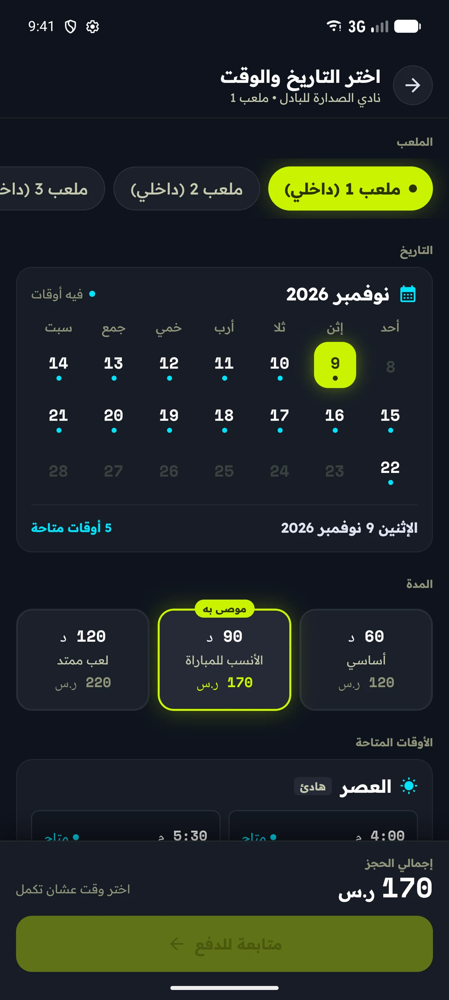
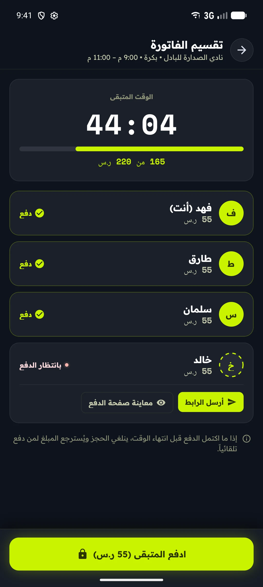
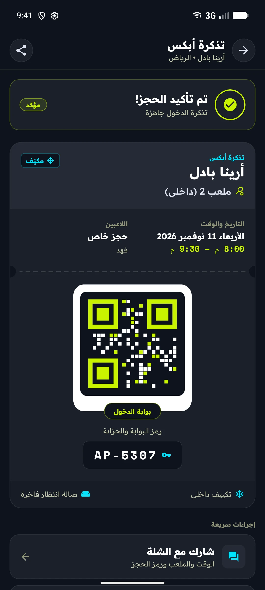

# أبكس بادل · Apex Padel

> **مشروع استعراضي مفتوح المصدر.** تصميم واجهات فقط (UI) ببيانات وهمية، مو تطبيق كامل: ما فيه خادم ولا دفع حقيقي ولا حسابات.
>
> **Open-source demo project.** UI only, with mock data: no backend, no real payments, no accounts.

<p align="center">
  
  
  
  
  
</p>

---

## العربي

تطبيق جوال لحجز ملاعب البادل في السعودية، مع صفحة هبوط بنفس الهوية. الواجهة عربية بالكامل (RTL)، والبيانات وهمية وسعودية: أندية في الرياض وجدة والخبر، والأسعار بالريال.

**المزايا:**
- اكتشاف الأندية حسب المدينة، مع التقييم والأسعار.
- حجز الملعب: اختيار اليوم والمدة والوقت المتاح.
- تقسيم الفاتورة على اللاعبين، وكل واحد يدفع نصيبه (مدى، Apple Pay، STC Pay، أو الدفع في الملعب).
- تذكرة المباراة برمز QR، مع عدّاد لموعد المباراة.

**المقطع:** قريباً.

### الهيكل

```
mobile/   تطبيق الجوال: Expo (SDK 58) + Expo Router + NativeWind
land/     صفحة الهبوط: Next.js 16 (App Router)
docs/     المواصفات ونظام التصميم وخطة التطوير
Dockerfile  يبني صفحة الهبوط ويشغّلها
```

### التشغيل

**التطبيق** (يحتاج Node 22 و Expo Go أو محاكي أندرويد):

```bash
cd mobile
npm install
npx expo start
```

**صفحة الهبوط:**

```bash
cd land
npm install
npm run dev
```

بعدها افتح `http://localhost:3000`.

**صفحة الهبوط بدوكر:**

```bash
docker build -t apex-padel-land .
docker run -p 3000:3000 apex-padel-land
```

رابط الموقع (للـ SEO وصورة المشاركة) في `.env.example`: انسخه إلى `land/.env.local` وعدّل `SITE_URL` قبل البناء.

---

## English

A mobile app for booking padel courts in Saudi Arabia, plus a landing page with the same identity. The interface is fully Arabic (RTL), and the mock data is Saudi: clubs in Riyadh, Jeddah and Khobar, with prices in SAR.

**Features:**
- Discover clubs by city, with ratings and prices.
- Book a court: pick the day, duration and an available slot.
- Split the bill between players, each paying their share (mada, Apple Pay, STC Pay, or pay at the venue).
- Match pass with a QR code and a countdown to the game.

**Video:** coming soon.

### Structure

```
mobile/   Mobile app: Expo (SDK 58) + Expo Router + NativeWind
land/     Landing page: Next.js 16 (App Router)
docs/     Spec, design system and development plan
Dockerfile  Builds and serves the landing page
```

### Running

**App** (needs Node 22 and Expo Go or an Android emulator):

```bash
cd mobile
npm install
npx expo start
```

**Landing page:**

```bash
cd land
npm install
npm run dev
```

Then open `http://localhost:3000`.

**Landing page with Docker:**

```bash
docker build -t apex-padel-land .
docker run -p 3000:3000 apex-padel-land
```

The site URL (for SEO and the share image) is in `.env.example`: copy it to `land/.env.local` and set `SITE_URL` before building.

---

## الرخصة · License

[MIT](LICENSE)
